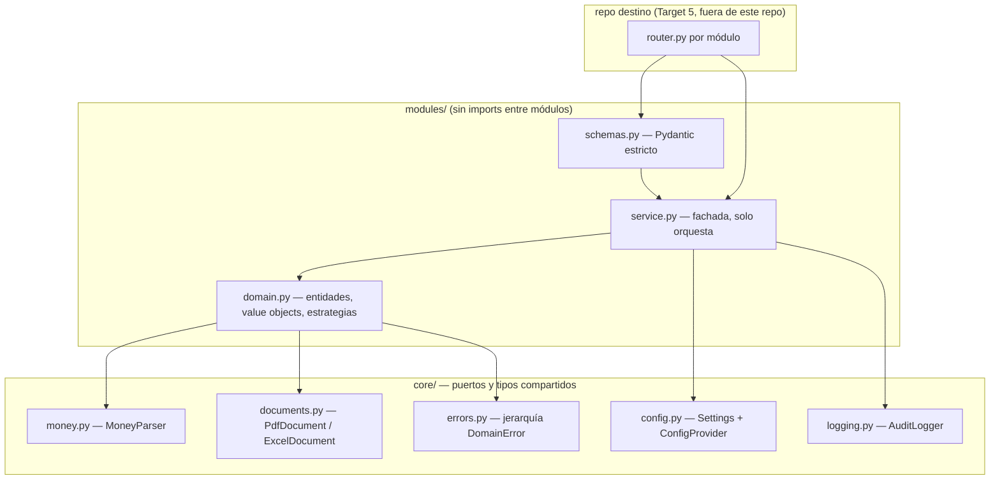
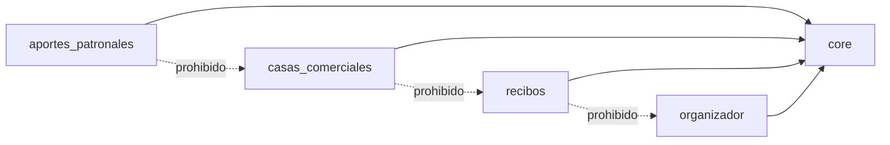
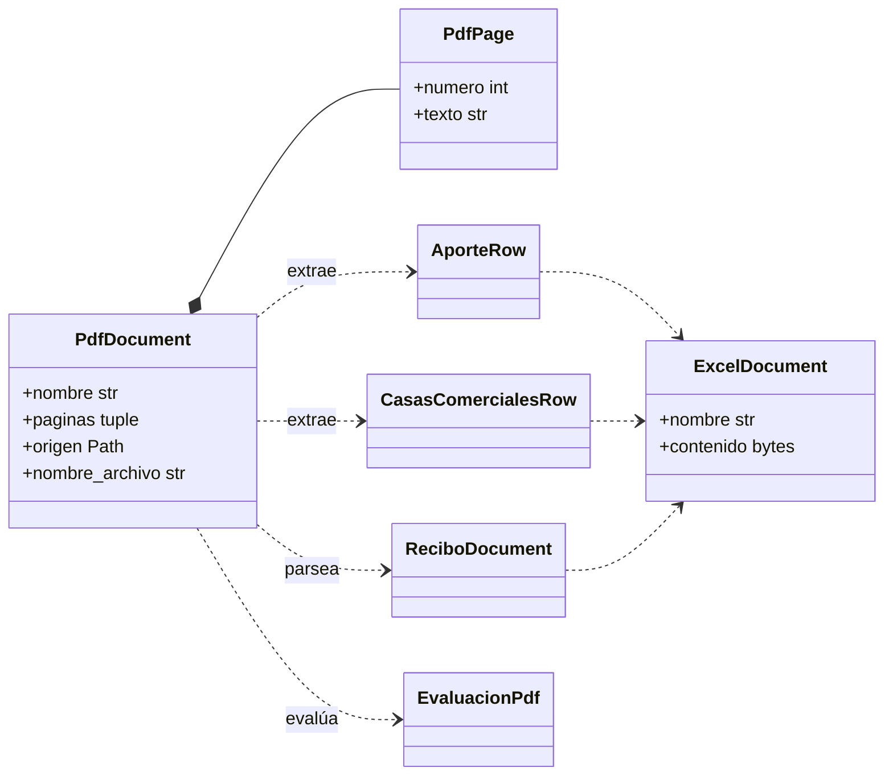
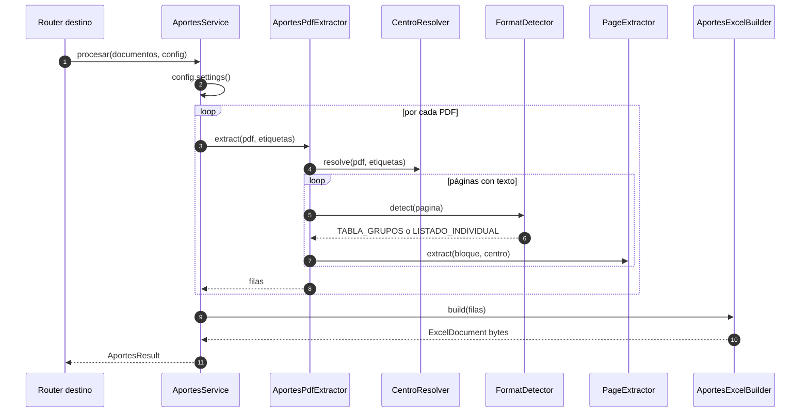
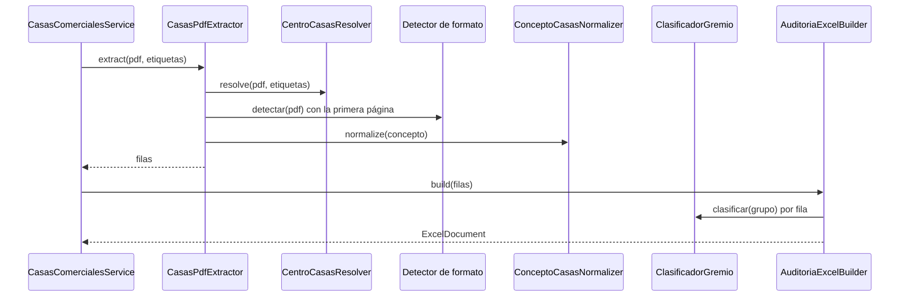
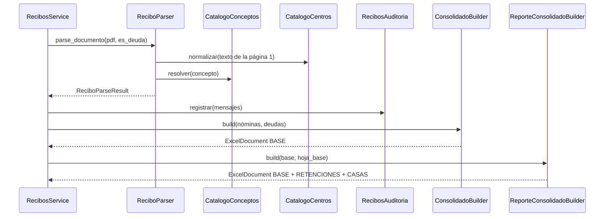
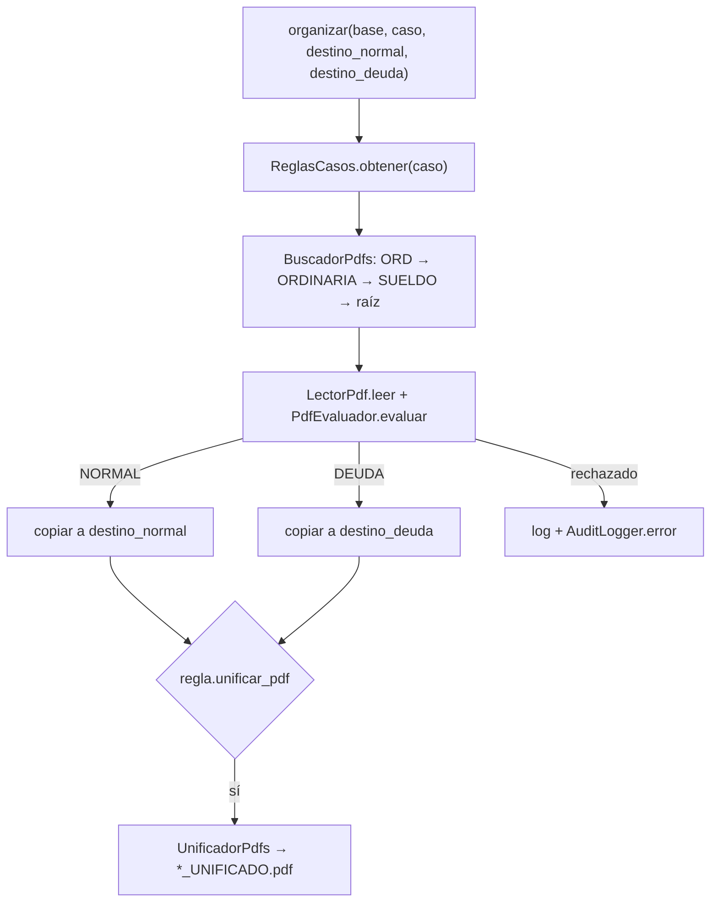
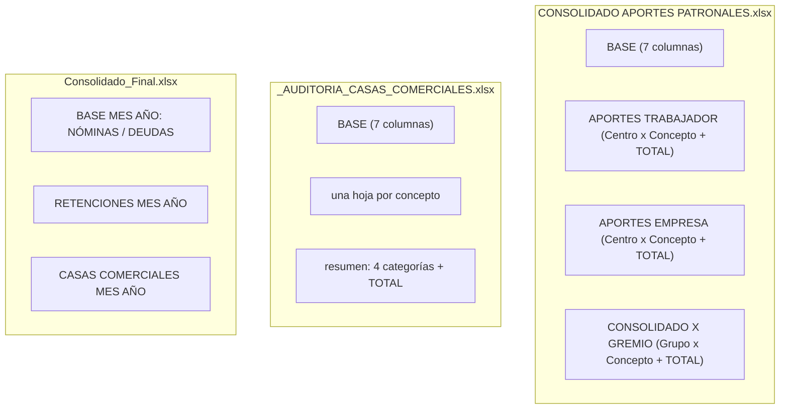
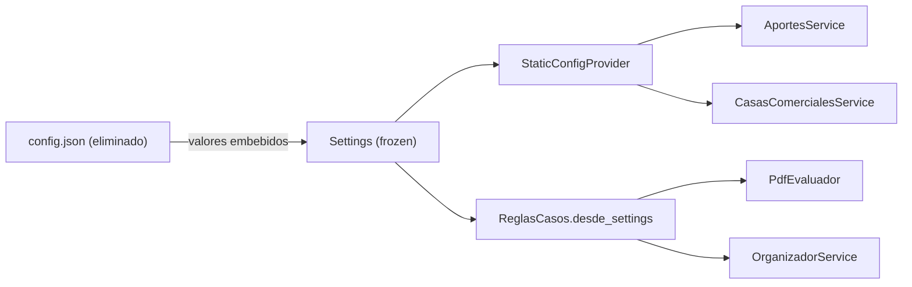
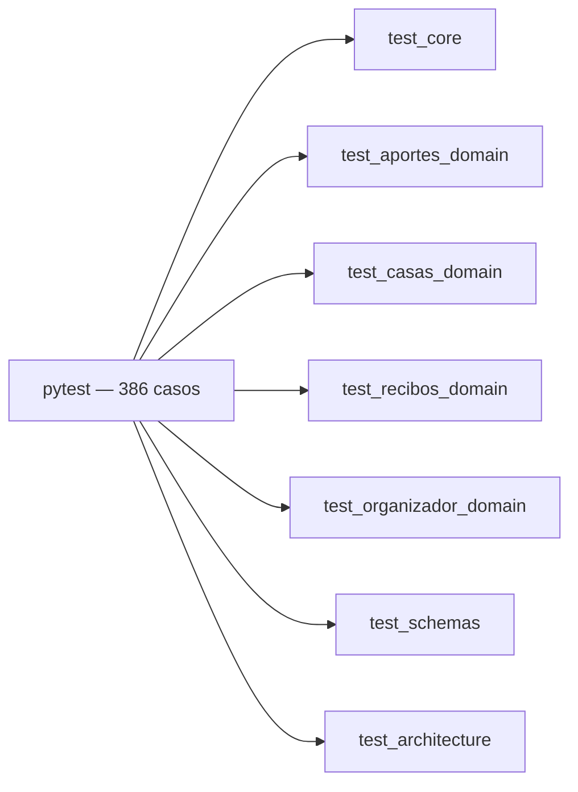

# CORPOSALUD-DEDUCCIONES

Sistema de deducciones de la Corporación de Salud del Estado Aragua. Este repo
es la migración desde los scripts de escritorio (tkinter + Excel nativo) a un
monolito modular compatible con FastAPI, según el `plan.md`.

**Estado:** Targets 0 a 4 completados en la rama `refactor`. El Target 5
(routers y wiring de FastAPI) vive en el repo destino; el Target 6 es la pasada
de endurecimiento pendiente.

## Índice rápido — ¿qué quiero saber?

| Pregunta | Ir a |
|---|---|
| ¿Qué módulos existen y qué hace cada uno? | [Qué hace cada módulo](#qué-hace-cada-módulo) |
| ¿Qué archivo de Excel genera cada caso de uso? | [Artefactos de Excel](#artefactos-de-excel) |
| ¿Dónde toco si quiero cambiar una regla? | [¿Dónde está cada cosa?](#dónde-está-cada-cosa) |
| ¿Cómo fluyen los datos? | [Diagramas](#diagramas) |
| ¿Qué se conservó y qué se corrigió del sistema viejo? | [MIGRACION.md](MIGRACION.md) |
| ¿Qué cubren los tests? | [tests/README.md](tests/README.md) |
| ¿Cómo corro el proyecto? | [Inicio rápido](#inicio-rápido) |

## Inicio rápido

    python3 -m venv .venv
    .venv/bin/python -m pip install -r requirements-dev.txt
    .venv/bin/python -m pytest

La suite tiene unos 386 casos y corre en menos de dos segundos. No necesita
Excel instalado: los libros se generan con openpyxl en memoria.

Dependencias de producción: `pydantic` (esquemas estrictos),
`openpyxl` (Excel), `pymupdf` (lectura de PDFs). Ya no se usan
`pandas`, `xlsxwriter`, `pdfplumber` ni `pywin32`.

## Mapa del repositorio

    core/
      config.py        Settings inmutable (reemplaza config.json) + ConfigProvider
      documents.py     PdfDocument, PdfPage, PdfFormat, ExcelDocument
      errors.py        DomainError, PdfExtractionError, ReportGenerationError, ConfigError
      logging.py       AuditLogger (puerto) + NullAuditLogger
      money.py         MoneyParser, CommaDotMoneyParser, LegacyReciboMoneyParser
    modules/
      aportes_patronales/   domain.py, schemas.py, service.py
      casas_comerciales/    domain.py, schemas.py, service.py
      recibos/              domain.py, schemas.py, service.py
      organizador/          domain.py, schemas.py, service.py
    tests/               suite pytest + README
    MIGRACION.md         mapa de archivos viejos y desviaciones
    plan.md              plan y contrato del repo destino
    requirements-dev.txt dependencias para correr los tests

Cada módulo respeta la misma forma: `domain.py` (entidades, value objects,
estrategias), `schemas.py` (Pydantic estricto en el borde) y
`service.py` (fachada que solo orquesta). Los módulos no se importan
entre sí; solo dependen de `core`.

## Qué hace cada módulo

| Módulo | Fachada | Entrada | Salida | Libro de Excel |
|---|---|---|---|---|
| `aportes_patronales` | `AportesService.procesar` | `Sequence[PdfDocument]` + `ConfigProvider` | `AportesResult` | `CONSOLIDADO APORTES PATRONALES.xlsx` |
| `casas_comerciales` | `CasasComercialesService.procesar` | `Sequence[PdfDocument]` + `ConfigProvider` | `ExcelDocument` | `_AUDITORIA_CASAS_COMERCIALES.xlsx` |
| `recibos` | `RecibosService`: `extraer`, `generar_reportes`, `resumir` | `Sequence[PdfDocument]` | `list[ReciboDocument]`, `ExcelDocument` | `Consolidado_Final.xlsx` |
| `organizador` | `OrganizadorService.organizar` | `Path` base, `CasoUso`, destinos | `OrganizacionResult` | PDFs copiados/unificados |

### aportes_patronales

Extrae aportes (trabajador y empresa) de los listados de aportes patronales y
arma el consolidado que antes se generaba con tablas dinámicas de Excel.

- **Formatos reconocidos por página:** `TABLA_GRUPOS` ("... por grupos de
  nómina") y `LISTADO_INDIVIDUAL` ("LISTADO DE ... AL dd/mm/aaaa"). Un
  mismo PDF puede mezclar ambos; se agrupan páginas consecutivas del mismo
  formato y cada bloque arranca sin estado prestado.
- **Reglas de extracción:** el concepto llega en la línea `CONCEPTO:`; los
  totales en `TOTAL DEDUCCIONES`; en el listado individual la cantidad es
  el conteo de líneas de trabajador y los dos últimos montos son trabajador y
  empresa.
- **Normalización de conceptos** (`ConceptoNormalizer`): `SSO`, `PIE`,
  `FPJ`, `FAOV`, `CAHORMINSAS`, `CAEMINSAS`,
  `CAJA DE AHORRO` y `SERVICIOS FUNERARIOS CAHORMINSAS`; el resto
  queda tal cual.
- **Clases clave:** `AportesPdfExtractor` (orquesta bloques),
  `PageExtractor` (flujo plantilla), `TablaGruposExtractor`,
  `ListadoIndividualExtractor`, `CentroResolver`,
  `FormatDetector` y `AportesExcelBuilder`.

### casas_comerciales

Procesa los listados de casas comerciales y genera la auditoría con cantidades
por gremio.

- **Detección de formato:** a nivel de archivo, mirando solo la primera página
  (así funcionaba el sistema original).
- **Normalización de conceptos** (`ConceptoCasasNormalizer`): unifica
  `CAHORMINSAS` y `CAEMINSA`; el resto se escribe en mayúsculas.
- **Clasificación de gremio** (`ClasificadorGremio`): `Empleados Fijos`,
  `Obreros Fijos`, `Empleados Contratados` y
  `Obreros Contratados`. Compara singulares literales en orden fijo; los
  grupos en plural no clasifican y quedan fuera del resumen.
- **Clases clave:** `CasasPdfExtractor`, `CentroCasasResolver`,
  `CasasComercialesRow` (acepta filas de aportes vía `Protocol`) y
  `AuditoriaExcelBuilder`. El resolvedor de centro comparte reglas con el
  de aportes (todas las páginas, primeras 8 líneas).

### recibos

Lee recibos de nómina y de deuda, deja auditoría en memoria y arma el
consolidado más los reportes de retenciones y casas comerciales.

- **Parseo** (`ReciboParser`): entidad desde la página 1
  (`CatalogoCentros`), número con `Recibo Nº <n>`, conceptos con
  `CatalogoConceptos` (gana siempre la clave más larga) y monto con el
  parser histórico de recibos (pierde el signo negativo).
- **Auditoría** (`RecibosAuditoria`): devuelve entradas
  `(nivel, mensaje)` en memoria; no escribe archivos de log.
- **Consolidado** (`ConsolidadoBuilder`): hoja `BASE <MES> <AÑO>`
  con bloque de nóminas y bloque de deudas, 4 columnas por bloque.
- **Reportes** (`ReporteConsolidadoBuilder`): agrega las hojas
  `RETENCIONES <MES> <AÑO>` y `CASAS COMERCIALES <MES> <AÑO>`,
  con búsqueda por código al final del concepto para evitar colisiones
  (`SISTRASALUD` no captura `FENASISTRASALUD`).
- **Resumen** (`ResumidorRecibos`): archivo → número de recibo.

### organizador

Clasifica PDFs por caso de uso, separa normales de deudas y opcionalmente
unifica cada subcarpeta. Sustituye al menú de consola y a los diálogos de
tkinter.

- **Casos:** `RECIBOS`, `APORTES_PATRONALES` y
  `CASAS_COMERCIALES`, cada uno con sus textos requeridos, mapa de
  conceptos, si unifica y si conserva el nombre de archivos "NO LEY".
- **Orden de barrido** (`BuscadorPdfs`): subcarpetas `ORD`,
  luego `ORDINARIA`, luego `SUELDO` y por último la raíz, sin
  duplicar archivos.
- **Evaluación** (`PdfEvaluador`): busca conceptos normalizados (sin
  tildes, sin guiones de corte, en mayúsculas) y marca `DEUDA` cuando
  aparece la palabra.
- **Nombres** (`RenombradorArchivos`): conserva el nombre original para
  "NO LEY"; si la regla lo pide agrega el concepto
  (`<SUBCARPETA>_<CONCEPTO>`) y resume a
  `<SUBCARPETA>_<CONCEPTO>_Y_<n>_MAS` cuando hay más de dos.
- **Resultado** (`OrganizacionResult`): log en memoria, rutas normales,
  deudas y unificados.

### core

| Archivo | Qué aporta |
|---|---|
| `config.py` | `Settings` inmutable con los valores del viejo config.json; `ConfigProvider` y `StaticConfigProvider` |
| `documents.py` | `PdfDocument` / `PdfPage` de entrada y `ExcelDocument` (nombre + bytes) de salida; `PdfFormat` |
| `errors.py` | base `DomainError` y errores tipados de extracción, reporte y configuración |
| `logging.py` | puerto `AuditLogger` y `NullAuditLogger` para tests |
| `money.py` | estrategias de parseo de montos a `Decimal` (aportes y recibos) |

## Artefactos de Excel

| Libro | Hojas | Contenido |
|---|---|---|
| `CONSOLIDADO APORTES PATRONALES.xlsx` | `BASE` | Centro, Grupo, Referencia, Concepto, Cant, Aporte Trabajador, Aporte Empresa |
| | `APORTES TRABAJADOR` | Centro en filas, concepto en columnas, suma de aporte trabajador y fila TOTAL |
| | `APORTES EMPRESA` | igual, con el aporte de la empresa |
| | `CONSOLIDADO X GREMIO` | Grupo en filas, concepto en columnas, suma de aporte empresa |
| `_AUDITORIA_CASAS_COMERCIALES.xlsx` | `BASE` | mismas 7 columnas |
| | una hoja por concepto | datos del concepto y resumen de 4 categorías de gremio + TOTAL |
| `Consolidado_Final.xlsx` | `BASE <MES> <AÑO>` | bloques `--- SECCIÓN NÓMINAS ---` y `--- SECCIÓN DEUDAS ---` (Conceptos, Entidad, Recibo, Montos) |
| | `RETENCIONES <MES> <AÑO>` | S.S.O., PÉRDIDA, PENSIONES y FAOV, con nombre normal o de deuda y fila TOTAL |
| | `CASAS COMERCIALES <MES> <AÑO>` | 25 conceptos emparejados por código final, con fila TOTAL |

## Diagramas

### Capas y responsabilidades

### Dependencias entre módulos

### Modelo de datos compartido

### Flujo de aportes patronales

### Flujo de casas comerciales

### Flujo de recibos

### Flujo del organizador

### Estructura de los libros generados

### Configuración

### Mapa de tests

## ¿Dónde está cada cosa?

| Quiero cambiar... | Archivo |
|---|---|
| Los valores por defecto de configuración | [core/config.py](core/config.py) |
| Las reglas de normalización de conceptos de aportes | [modules/aportes_patronales/domain.py](modules/aportes_patronales/domain.py) |
| La resolución del centro (aportes o casas) | `CentroResolver` / `CentroCasasResolver` |
| Las columnas del consolidado de aportes | `AportesExcelBuilder` |
| Las categorías de gremio | `ClasificadorGremio` |
| El resumen de la auditoría de casas | `AuditoriaExcelBuilder._escribir_resumen` |
| Los códigos de concepto de recibos | [modules/recibos/domain.py](modules/recibos/domain.py) |
| Los alias de centros de recibos | `MAPEO_CENTROS` en el mismo archivo |
| Las hojas RETENCIONES / CASAS | `ReporteConsolidadoBuilder` |
| Las reglas de cada caso del organizador | `ReglasCasos.desde_settings` y `TEXTOS_*` |
| El nombre de los archivos copiados | `RenombradorArchivos.nombre_base` |
| El orden de búsqueda de PDFs | `BuscadorPdfs` |
| El parser de montos | [core/money.py](core/money.py) |
| Los esquemas de la API | `schemas.py` de cada módulo |
| Los errores de dominio | [core/errors.py](core/errors.py) |

## Reglas de arquitectura

La suite ([tests/test_architecture.py](tests/test_architecture.py)) verifica:

- los archivos heredados siguen borrados y no hay rutas mágicas ni GUI;
- no aparecen `tkinter`, `win32com`, `pandas`,
  `pdfplumber`, `xlsxwriter`, `os.startfile`,
  `__file__` ni `Desktop` en el código de producción;
- ningún módulo importa a otro y `core` no conoce a `modules`;
- `service.py` declara una sola fachada y no define funciones sueltas;
- los value objects son `dataclass(frozen=True)` y los conjuntos cerrados son
  `Enum`;
- los puertos (`MoneyParser`, `AuditLogger`,
  `ConfigProvider`, `ReportBuilder`, `PageExtractor`,
  `LectorPdf`) no se pueden instanciar.

## Documentación relacionada

- [plan.md](plan.md): objetivos, contrato del repo destino y rationale de diseño.
- [MIGRACION.md](MIGRACION.md): mapa de archivos viejos → nuevos, rarezas
  conservadas y desviaciones.
- [tests/README.md](tests/README.md): qué cubre cada archivo de tests.
